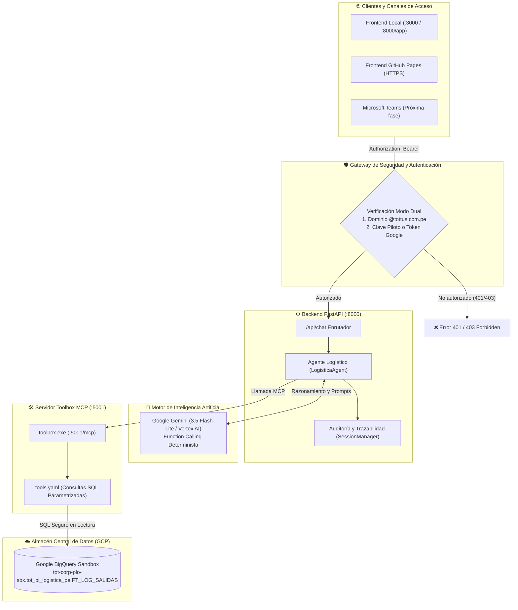

# 🚛 Tottus Logistics AI Agent — Backend API Gateway 🇵🇪
### Motor de Inteligencia Operativa, Orquestación con Gemini y Acceso Seguro a BigQuery

Este repositorio contiene el **Backend y Motor de Inteligencia Artificial** del Asistente de Transporte y Despachos de **Tottus Perú (Falabella)**. Proporciona una arquitectura de API Gateway con FastAPI, orquestación de modelos de lenguaje con **Google Gemini**, integración de herramientas de datos con **Toolbox MCP** sobre **Google BigQuery**, y un sistema de control de acceso corporativo blindado en **Modo Dual**.

---

## 🏛️ Arquitectura del Sistema



---

## 🔐 Seguridad y Control de Acceso (Modo Dual)

El backend implementa un mecanismo de defensa en profundidad para garantizar que **ningún dato corporativo de BigQuery sea expuesto a personas no autorizadas**:

### 1. Validación Estricta de Dominio Corporativo
En el cuerpo de cada petición (`ChatRequest`), el campo `user_email` es analizado.
* **Regla:** Debe terminar obligatoriamente en `@tottus.com.pe`.
* **Respuesta ante fallo:** `403 Forbidden` (*"Acceso denegado: El asistente logístico está restringido exclusivamente a colaboradores con cuenta corporativa @tottus.com.pe"*).

### 2. Validación de Credencial en Cabecera HTTP (`Authorization`)
El endpoint `/api/chat` evalúa la cabecera `Authorization: Bearer <token>` bajo dos modalidades simultáneas:

* **Modo A (Piloto Actual — Activo):**
  * La credencial enviada se compara contra la variable `PILOT_ACCESS_KEY` configurada en el archivo local `.env` (clave por defecto: `D4t4-PL$2026`).
  * Utiliza la función criptográfica `secrets.compare_digest()` de Python para prevenir ataques avanzados de temporización (*timing attacks*).
* **Modo B (Google OAuth 2.0 — Preparado para Producción):**
  * Si en el futuro el equipo de TI de Falabella otorga un `GOOGLE_CLIENT_ID`, este se agrega al `.env`.
  * El backend intentará automáticamente validar la firma criptográfica del token JWT recibido con los servidores de Google (`google.oauth2.id_token.verify_oauth2_token`).
* **Respuesta ante fallo:** `401 Unauthorized` (*"Credencial no autorizada. Ingresa la clave válida del piloto o inicia sesión con tu cuenta corporativa"*).

### 3. Control por Lista Blanca de Colaboradores (Whitelist RBAC)
Para garantizar que **nadie pueda inventar usuarios** incluso conociendo la clave secreta o habiéndose autenticado con Google:
* **Variable en `.env`:** `ALLOWED_USERS=fhurtadoa@tottus.com.pe,companero1@tottus.com.pe`
* Si la variable contiene correos, el backend **solo permitirá procesar preguntas a esas cuentas específicas**.
* Si un usuario escribe un correo no autorizado, recibe `403 Forbidden` (*"Acceso denegado: La cuenta no figura en la lista de colaboradores autorizados para este piloto"*).
* **Flexibilidad total:** Para abrir el acceso a cualquier colaborador de Tottus en el futuro, solo se deja `ALLOWED_USERS=` vacío o con `*` en el `.env`.

---

## 🛠️ Catálogo de Herramientas Analíticas MCP (`tools.yaml`)

El servidor Toolbox MCP (`toolbox.exe`) traduce las intenciones de Gemini en consultas SQL optimizadas sobre la tabla particionada `tot-corp-plo-sbx.tot_bi_logistica_pe.FT_LOG_SALIDAS`:

| # | Herramienta | Parámetros | Propósito Operativo |
| :--- | :--- | :--- | :--- |
| **1** | `resumen_carga_transporte` | `tim`, `placa`, `tienda`, `fecha` | Consolida despachos por camión o transferencia. Devuelve placa, fecha, total cajas, unidades, peso (kg) y volumen (m³). |
| **2** | `consultar_despachos_logistica` | `tim`, `tienda`, `sku`, `pagina` | Detalle fino a nivel de producto/SKU (código de barra, descripción del artículo, cantidades despachadas). |
| **3** | `resumen_despachos_por_division` | `tienda`, `dias_atras` | Desglose agregado por división comercial (J01 Abarrotes, J02 Perecibles, Carnes, etc.). |
| **4** | `alertas_vencimiento_transito` | `tienda`, `dias_margen` | Control preventivo de calidad. Identifica productos perecibles próximos a vencer que se encuentran en tránsito. |
| **5** | `buscar_por_shipment_o_do` | `shipment`, `trf_do` | Rastreo logístico cuando el usuario no cuenta con el TIM pero tiene el número de Shipment o DO (Delivery Order). |
| **6** | `buscar_tienda_por_nombre` | `nombre_parcial` | Resuelve nombres comunes (ej. "Angamos", "San Luis", "Huánuco") a sus códigos ID oficiales ('123', '114', '451'). |

---

## 📡 Catálogo de Endpoints de la API

La aplicación expone una API REST moderna documentada automáticamente bajo el estándar OpenAPI:

* **Documentación interactiva Swagger UI:** `http://localhost:8000/docs`
* **Especificación OpenAPI (JSON):** `http://localhost:8000/openapi.json`

### 1. `POST /api/chat`
Endpoint principal conversacional.
* **Headers requeridos:**
  * `Content-Type: application/json`
  * `Authorization: Bearer <PILOT_KEY_O_GOOGLE_TOKEN>`
* **Cuerpo de la petición (JSON):**
  ```json
  {
    "message": "¿Qué camiones salieron a la tienda 451 de Huánuco ayer?",
    "session_id": "session_abc123",
    "tienda_id": "451",
    "user_email": "colaborador@tottus.com.pe",
    "include_data": true,
    "pais": "PE"
  }
  ```
* **Respuesta (JSON):**
  ```json
  {
    "answer": "Se identificó 1 camión despachado a la tienda Huánuco...",
    "session_id": "session_abc123",
    "tools_executed": [
      {
        "tool_name": "resumen_carga_transporte",
        "arguments": { "tienda": "451" },
        "result_count": 1
      }
    ],
    "data": [ ... ]
  }
  ```

### 2. `GET /api/health`
Monitoreo de estado de salud del sistema.
* Verifica conectividad con el servidor Toolbox MCP en el puerto `5001`.
* Lista las herramientas activas en BigQuery y el modelo de IA configurado.

### 3. `GET /api/tools`
Devuelve el esquema OpenAPI y las descripciones de todas las herramientas MCP disponibles.

### 4. `POST /api/cache/clear`
Purga la memoria caché en memoria de consultas MCP para forzar a BigQuery a recalcular datos en tiempo real.

### 5. `GET /api/sessions` y `GET /api/sessions/{session_id}`
Auditoría y trazabilidad completa de consultas realizadas por usuario y tienda.

---

## 📁 Estructura del Proyecto

```
agent-test/
├── backend/
│   ├── main.py                  # Entrada principal FastAPI, middlewares CORS y montaje estático
│   ├── config.py                # Gestor de variables de entorno (.env) y configuración
│   ├── models.py                # Esquemas de datos Pydantic (Request, Response, Auditoría)
│   ├── routers/
│   │   └── chat.py              # Rutas /api/chat, /api/health, /api/tools con seguridad dual
│   ├── agents/
│   │   ├── _shared/
│   │   │   └── loader.py        # Cliente HTTP asíncrono para Toolbox MCP
│   │   └── logistica/
│   │       ├── agent.py         # Orquestador del ciclo de vida de Gemini y Function Calling
│   │       └── prompts.py       # Directivas del sistema, reglas de negocio y glosario operativo
│   └── services/
│       └── session_manager.py   # Resguardo persistente de sesiones para auditoría
├── toolbox/
│   ├── tools.yaml               # Definición declarativa de consultas BigQuery MCP
│   └── toolbox.exe              # Binario ejecutable del servidor Model Context Protocol
├── .env                         # Variables de entorno secretas (Ignorado en Git)
└── README.md                    # Esta documentación técnica
```

---

## 🚀 Guía de Puesta en Marcha (Entorno Local)

Para iniciar el backend en tu equipo de desarrollo, necesitas dos terminales de PowerShell o CMD en la carpeta `agent-test`:

### Terminal 1: Iniciar el Servidor de Datos MCP
```powershell
.\toolbox.exe --config toolbox\tools.yaml --port 5001
```
*(Debe mostrar: `MCP server started on port 5001`)*

### Terminal 2: Iniciar el Servidor FastAPI
```powershell
uvicorn backend.main:app --reload --port 8000
```
*(Debe mostrar: `Uvicorn running on http://127.0.0.1:8000` y `Toolbox MCP conectado exitosamente`)*

---

## 🔗 Armonización con el Frontend y Pruebas Remotas

### 1. Pruebas Locales
El backend tiene la capacidad automática de servir el frontend localmente sin servidores web adicionales:
* Visita directamente: 👉 **`http://localhost:8000/app/`**
* O abre tu frontend con Live Server / `python -m http.server 3000`.

### 2. Pruebas Remotas con Compañeros (GitHub Pages + Dev Tunnels)
1. En tu VS Code, abre la pestaña **Puertos (Ports)**.
2. Agrega el puerto `8000` y establece la visibilidad en **Público**.
3. Copia el enlace HTTPS generado (ej. `https://xxxx-8000.use.devtunnels.ms`).
4. Tus compañeros entran a tu web de **GitHub Pages**, hacen clic en el botón `🌐 Servidor Backend` en la pantalla de bienvenida y pegan esa URL.
5. Ingresan con su correo institucional `@tottus.com.pe` y la clave secreta: **`D4t4-PL$2026`**.
6. ¡Listo! Pueden interactuar con el agente en tiempo real mientras el backend procesa de forma segura en tu equipo.
