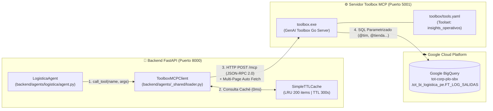

# 🛠️ Arquitectura, Gobernanza y Catálogo Técnico del Servidor MCP (`Toolbox MCP`)
### Documentación Técnica para TI, Arquitectura y Gobernanza de Datos — Tottus Perú 🇵🇪

Este documento describe en detalle la arquitectura, el modelo de seguridad SQL, las reglas de negocio y el catálogo completo de herramientas del servidor **Model Context Protocol (MCP)** implementado en el repositorio `agent-test` mediante [`toolbox/tools.yaml`](../toolbox/tools.yaml) y el cliente asíncrono [`backend/agents/_shared/loader.py`](../backend/agents/_shared/loader.py).

---

## 1. Propósito y Resumen Ejecutivo

El proyecto utiliza **GenAI Toolbox for Databases** (`toolbox.exe` / `genai-toolbox`), el servidor MCP oficial de Google para bases de datos empresariales, con el objetivo de desacoplar el modelo de lenguaje (**Google Gemini**) del motor analítico (**Google BigQuery**).

### Beneficios para TI y Seguridad Corporativa:
1. **Cero Generación de SQL Libre (Prevención de SQL Injection):** El LLM **nunca** escribe sentencias SQL arbitrarias. Únicamente puede invocar herramientas predefinidas en [`toolbox/tools.yaml`](../toolbox/tools.yaml) enviando parámetros fuertemente tipados (`string`, `integer`).
2. **Consultas de Solo Lectura Gobernadas:** Todas las sentencias son `SELECT` parametrizadas (`@param`) con filtros obligatorios de ventana de partición (`Fecha_Enviado`) y límites de filas (`LIMIT`), protegiendo el consumo de cómputo (slots/bytes procesados) en BigQuery.
3. **Estándar Abierto JSON-RPC 2.0 (MCP):** Expone un contrato estándar en el endpoint `/mcp` (`tools/list` y `tools/call`), reutilizable desde FastAPI, Google ADK, Microsoft Copilot Studio u otros agentes corporativos.
4. **Credenciales Centralizadas (ADC):** La conexión hacia BigQuery se realiza desde el servidor MCP mediante *Application Default Credentials* (ADC) o la *Service Account* de Cloud Run, sin exponer llaves privadas a los clientes web.

---

## 2. Arquitectura de Comunicación MCP



---

## 3. Fuente de Datos y Controles en BigQuery

### 3.1. Definición de la Fuente (`sources`)
En [`toolbox/tools.yaml`](../toolbox/tools.yaml#L4-L7), la conexión se declara apuntando al proyecto de BigQuery:

```yaml
sources:
  bigquery_logistica_sbx:
    kind: bigquery
    project: tot-corp-plo-sbx
```

* **Tabla Maestra Consultada:** `tot-corp-plo-sbx.tot_bi_logistica_pe.FT_LOG_SALIDAS`
* **Zona Horaria de Referencia:** `America/Lima` (`CURRENT_DATE("America/Lima")`).

### 3.2. Reglas de Cálculo de *Lead Time* y Llegada Estimada en SQL
Tanto las consultas SQL de [`toolbox/tools.yaml`](../toolbox/tools.yaml) como el post-procesador del agente ([`_enrich_rows_with_arrival_estimates`](../backend/agents/logistica/agent.py#L401-L448)) aplican la regla oficial de transporte según el prefijo del código de tienda (`Tienda`):

| Prefijo de `Tienda` | Zona Geográfica | `lead_time_horas` | Cálculo de `fecha_estimada_llegada` |
| :---: | :--- | :---: | :--- |
| **`1xx`** | Tiendas Locales (Lima y Callao, ej. `107`, `114`, `123`) | **24 horas** | `Hora_de_Carga + 24 horas` (o `Fecha_Enviado + 1 día`) |
| **`3xx`** | Tiendas Provincia (ej. `301`, `305`) | **48 horas** | `Hora_de_Carga + 48 horas` (o `Fecha_Enviado + 2 días`) |
| **`4xx`** | Tiendas Oriente / Selva (ej. `451` Huánuco) | **72 horas** | `Hora_de_Carga + 72 horas` (o `Fecha_Enviado + 3 días`) |
| **Otros** | Resto de sedes | **96 horas** | `Hora_de_Carga + 96 horas` (o `Fecha_Enviado + 4 días`) |

---

## 4. Catálogo Detallado de Herramientas (`toolbox/tools.yaml`)

El toolset activo **`insights_operativos`** registra **7 herramientas operativas** en producción y mantiene **1 herramienta en cuarentena** como plantilla futura:

---

### 🛠️ Herramienta 1: `consultar_despachos_logistica`
* **Propósito:** Consulta el detalle fino a nivel de **productos / SKUs individuales** despachados o en tránsito desde el CD hacia las tiendas en los últimos **31 días**.
* **Cuándo la invoca el agente:** Solo cuando el usuario pregunta por artículos, mercadería, SKUs o el contenido detallado dentro de un TIM o camión.
* **Parámetros de entrada:**

| Parámetro | Tipo | Requerido | Descripción |
| :--- | :---: | :---: | :--- |
| `tim` | `integer` | No | Número identificador del TIM logístico (ej. `655425244`). |
| `tienda` | `string` | No | Código ID de la tienda destino (ej. `'123'`, `'114'`). |
| `sku` | `string` | No | Código SKU del producto puntual. |
| `placa` | `string` | No | Placa del camión de transporte. |
| `pagina` | `integer` | No | Número de página (bloques de 50 filas). Si se omite, trae todos los registros (hasta 5,000). |

* **Columnas devueltas:** `tim`, `Shipment`, `Placa`, `sku`, `Descripcion`, `Trf_DO`, `Tipo_DO`, `Inventario_Whse`, `Tienda`, `Nombre_Tienda`, `Fecha_Enviado`, `hora_carga`, `lead_time_horas`, `fecha_estimada_llegada`.

---

### 🛠️ Herramienta 2: `resumen_carga_transporte`
* **Propósito:** Calcula el **consolidado de carga agrupado por transferencia (`tim`) y camión (`Placa`)** hacia una tienda en una fecha o rango de fechas (ventana máxima de 31 días).
* **Cuándo la invoca el agente:** Consultas de camiones despachados a una tienda, placas, hora de carga de un TIM, peso, volumen, pallets o cajas totales.
* **Parámetros de entrada:**

| Parámetro | Tipo | Requerido | Descripción |
| :--- | :---: | :---: | :--- |
| `tim` | `integer` | No | Número TIM de la transferencia. |
| `placa` | `string` | No | Placa del camión de transporte (ej. `'BHL888'`). |
| `tienda` | `string` | No | Código ID de la tienda destino (ej. `'123'`, `'451'`). |
| `fecha` | `string` | No | Fecha puntual de despacho o fecha de inicio (`YYYY-MM-DD`). |
| `fecha_fin` | `string` | No | Fecha final (`YYYY-MM-DD`) cuando se consulta un rango de fechas. |
| `pagina` | `integer` | No | Número de página (bloques de 50 filas). |

* **Métricas y columnas devueltas:**
  * Identificadores: `tim`, `Placa`, `Tienda`, `Nombre_Tienda`, `Inventario_Whse`.
  * Tiempos: `fecha_despacho` (`DATE(Fecha_Enviado)`), `hora_carga` (`MAX(Hora_de_Carga)`), `lead_time_horas`, `fecha_estimada_llegada`.
  * Volumetría agregada: `total_pallets` (`COUNT(DISTINCT Pallet)`), `total_skus_distintos` (`COUNT(DISTINCT sku)`), `total_unidades` (`SUM(Unidades)`), `total_cajas` (`SUM(Cajas)`), `peso_total_kg` (`SUM(Peso_Total)`), `volumen_total_m3` (`SUM(Vol_Enviado)`).

---

### 🛠️ Herramienta 3: `resumen_despachos_por_division`
* **Propósito:** Agrega las unidades, cajas, peso y cantidad de envíos (`tim`) despachados a una tienda desglosados por **División Comercial (`Division`, ej. J01 a J11)**.
* **Parámetros de entrada:**

| Parámetro | Tipo | Requerido | Descripción |
| :--- | :---: | :---: | :--- |
| `tienda` | `string` | **Sí** | ID de la tienda destino (ej. `'123'`). |
| `dias_atras` | `integer` | No | Días hacia atrás a consultar (por defecto `7` días). |

* **Columnas devueltas:** `Division`, `total_skus`, `total_unidades`, `total_cajas`, `peso_total_kg`, `total_envios_tim`.

---

### 🛠️ Herramienta 4: `alertas_vencimiento_transito`
* **Propósito:** Control preventivo de calidad para perecibles. Identifica productos despachados en los últimos 15 días cuya `Fecha_Vencimiento` esté próxima a cumplirse.
* **Parámetros de entrada:**

| Parámetro | Tipo | Requerido | Descripción |
| :--- | :---: | :---: | :--- |
| `tienda` | `string` | **Sí** | ID de la tienda destino (ej. `'123'`). |
| `dias_margen` | `integer` | No | Umbral máximo de días antes del vencimiento (por defecto `15` días). |

* **Columnas devueltas:** `sku`, `Descripcion`, `Division`, `Fecha_Vencimiento`, `dias_para_vencer`, `Unidades`, `Cajas`, `tim`, `Placa`, `Fecha_Enviado` (`LIMIT 50`).

---

### 🛠️ Herramienta 5: `buscar_por_shipment_o_do`
* **Propósito:** Permite rastrear un despacho cuando el usuario no conoce el código `TIM`, pero cuenta con el número de embarque (`Shipment`) o la orden de entrega (`Trf_DO` / Delivery Order).
* **Parámetros de entrada:**

| Parámetro | Tipo | Requerido | Descripción |
| :--- | :---: | :---: | :--- |
| `shipment` | `string` | No | Identificador del embarque logístico (ej. `'90327449'`). |
| `trf_do` | `string` | No | Número de Delivery Order (ej. `'22796787'`). |

* **Columnas devueltas:** `tim`, `Shipment`, `Trf_DO`, `Tipo_DO`, `Placa`, `Tienda`, `Nombre_Tienda`, `Inventario_Whse`, `hora_carga`, `fecha_despacho`, `total_skus`, `total_unidades`, `total_cajas`, `peso_total_kg` (`LIMIT 20`).

---

### 🛠️ Herramienta 6: `buscar_tienda_por_nombre`
* **Propósito:** Valida si una tienda existe en la base de datos logística y resuelve su nombre comercial parcial (ej. `'Angamos'`, `'Huanuco'`, `'Atocongo'`) o código numérico (`'123'`, `'451'`) hacia su ID y nombre oficial.
* **Parámetros de entrada:**

| Parámetro | Tipo | Requerido | Descripción |
| :--- | :---: | :---: | :--- |
| `nombre_parcial` | `string` | **Sí** | Nombre comercial o código numérico ID de la tienda a validar. |

* **Columnas devueltas:** `tienda_id`, `Nombre_Tienda`, `total_despachos_recientes`, `ultimo_despacho_registrado` (`LIMIT 10`).

---

### 🛠️ Herramienta 7: `consultar_cargas_pendientes_despacho`
* **Propósito:** Identifica camiones (`Placa`) y transferencias (`tim`) que ya fueron cargados en el Centro de Distribución (`Hora_de_Carga IS NOT NULL`) dentro de los últimos $N$ días para seguimiento de salidas pendientes.
* **Parámetros de entrada:**

| Parámetro | Tipo | Requerido | Descripción |
| :--- | :---: | :---: | :--- |
| `tienda` | `string` | No | Código ID de la tienda destino (opcional para ver todas las tiendas). |
| `placa` | `string` | No | Placa del camión (opcional). |
| `dias_atras` | `integer` | No | Ventana de días hacia atrás (por defecto `15` días). |

* **Columnas devueltas:** `tim`, `Placa`, `Tienda`, `Nombre_Tienda`, `Inventario_Whse`, `hora_carga`, `lead_time_horas`, `fecha_estimada_llegada`, `total_pallets`, `total_skus_distintos`, `total_unidades`, `total_cajas`, `peso_total_kg`, `volumen_total_m3` (`LIMIT 100`).

---

### 🔒 Herramienta 8 (En Cuarentena / No Expuesta en MCP): `consultar_estado_pedido_oc`
* Definida en [`toolbox/tools.yaml`](../toolbox/tools.yaml#L437-L465) como plantilla futura para órdenes de compra (`@tim`, `@oc`), pero **comentada y excluida** del toolset `insights_operativos` ([línea 479](../toolbox/tools.yaml#L479)) para garantizar que el agente no la invoque en producción.

---

### 📍 Herramienta Híbrida Complementaria (En Proceso Python): `consultar_monitoreo_provincia`
Además de las 7 herramientas SQL servidas por `toolbox.exe` sobre BigQuery, [`LogisticaAgent`](../backend/agents/logistica/agent.py#L248-L261) expone una 8ª herramienta de *Function Calling* ejecutada localmente por [`MonitoreoService`](../backend/services/monitoreo_service.py):
* **Fuente de datos:** Archivo Excel sincronizado de SharePoint (`Monitoreo General UT Provincia 2030.xlsx`, hoja `Perú`, `Tabla3`).
* **Alcance:** Tiendas de Provincia (`3xx`) y Oriente (`4xx`).
* **Capacidades:** Lectura sin bloqueo (`Win32 FILE_SHARE_READ | FILE_SHARE_WRITE`), parser dual (`OpenPyXL` + `XML` nativo), caché en memoria invalidada por `mtime`, detección de carga **ÚNICA vs COMPARTIDA** (ventana de $\pm 2\text{ horas}$ en `FIN DE CARGA`) y reconstrucción del itinerario de paradas (`Punto 1, 2, 3`).

---

## 5. Optimizaciones y Resiliencia en el Cliente MCP (`loader.py` y `agent.py`)

El cliente [`ToolboxMCPClient`](../backend/agents/_shared/loader.py#L41-L180) incorpora tres mecanismos técnicos clave:

1. **Caché en Memoria de Alta Velocidad (`SimpleTTLCache`):**
   * Almacena hasta `200` consultas recientes con un tiempo de vida (`TTL`) de **300 segundos (5 minutos)**.
   * Nunca guarda en caché respuestas vacías (`[]`), evitando que una consulta sin datos bloquee actualizaciones posteriores.
   * Puede purgarse manualmente vía `POST /api/cache/clear`.
2. **Paginación Automática Transparente (*Multi-Page Auto Fetch*):**
   * Para `consultar_despachos_logistica` y `resumen_carga_transporte`, si el usuario requiere el listado completo (ej. todos los SKUs de un TIM grande), `loader.py` itera automáticamente página por página (`pagina = 1, 2, ...` en lotes de 50 filas) hasta recuperar la totalidad de registros (máximo 100 páginas / 5,000 filas).
3. **Normalización y Enrutamiento Defensivo (`LogisticaAgent`):**
   * [`_resolve_tool_name()`](../backend/agents/logistica/agent.py#L296-L340) corrige variaciones de nombres si el LLM omite guiones bajos o traduce preposiciones.
   * Si el LLM invoca `consultar_despachos_logistica` pasando únicamente `tienda` (sin `tim` ni `sku`), el orquestador redirige automáticamente la llamada a `resumen_carga_transporte` para entregar la tabla consolidada de camiones/TIMs en lugar de miles de líneas de SKUs sueltos.

---

## 6. Ejecución y Pruebas del Servidor MCP

### 6.1. Iniciar el Servidor MCP Localmente
Desde la raíz de `agent-test`:
```powershell
.\toolbox.exe --config toolbox\tools.yaml --port 5001
```

### 6.2. Ejemplo de Petición Directa JSON-RPC 2.0 (`tools/call`)
Puedes verificar el servidor MCP de forma aislada (sin pasar por FastAPI ni Gemini) ejecutando el script [`probar_mcp.py`](../probar_mcp.py) o enviando un `POST` a `http://localhost:5001/mcp`:

```powershell
Invoke-RestMethod -Uri "http://localhost:5001/mcp" `
  -Method Post `
  -ContentType "application/json" `
  -Body '{
    "jsonrpc": "2.0",
    "id": 1,
    "method": "tools/call",
    "params": {
      "name": "buscar_tienda_por_nombre",
      "arguments": { "nombre_parcial": "Angamos" }
    }
  }'
```
